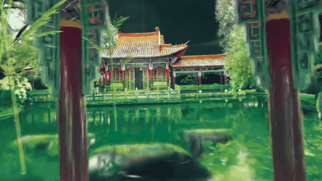

# Wuxing Meridian — Five Elements Garden

A guided VR meditation inside a Gaussian-splat scan of the China Garden in Zurich. You float over the lake, choose one of the five elements, and breathe with the garden: bamboo sways, a lantern glows, rain rings the pond, all paced to a 4-2-6 breath.

Wood, Fire and Water are playable. Metal and Earth are planned.
The project began as Inner Weather Garden, a garden that mirrored perimenopausal heat and cold, and became a meditation.

## Try it

**Meta Quest**
1. Put on the headset.
2. Open **Meta Quest Browser**.
3. Go to `https://wangqing-li.github.io/inner-weather-garden/wuxing2.html`
4. Tap **Enter VR** at the bottom of the page.
5. Pinch a glowing card with your thumb and forefinger.
6. To leave a scene, press your palms together for 3 seconds (controllers: hold the grip button for 1 second).

## Credits

- **Scan:** Xgrids LiDAR scan of the China Garden, Zurich, made for the course.
- **Rendering:** [three.js](https://threejs.org) 0.180.0, [Spark](https://sparkjs.dev) 2.4.0 for Gaussian splats.
- **Body:** legs and hands cut from *Lowpoly Female Body Stylized* by Rafasilart ([Sketchfab](https://sketchfab.com/3d-models/lowpoly-female-body-stylized-57e2dbcff0db468db02ac712eae59070)), CC BY-NC.
- **Voice:** macOS text-to-speech (Samantha). Script: Kengkeng.
- **Sounds:** bowl, wind, birds, rain, chimes and crackle are made in code with the Web Audio API.
- **Fonts:** Ma Shan Zheng and Playfair Display (Google Fonts, SIL Open Font License).
- Built with the help of Claude (Anthropic) as a coding assistant.
