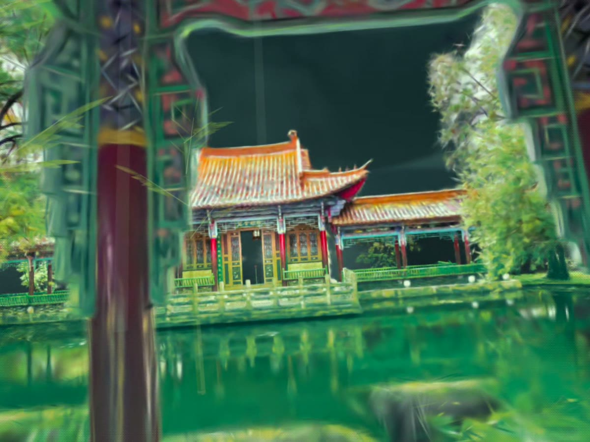
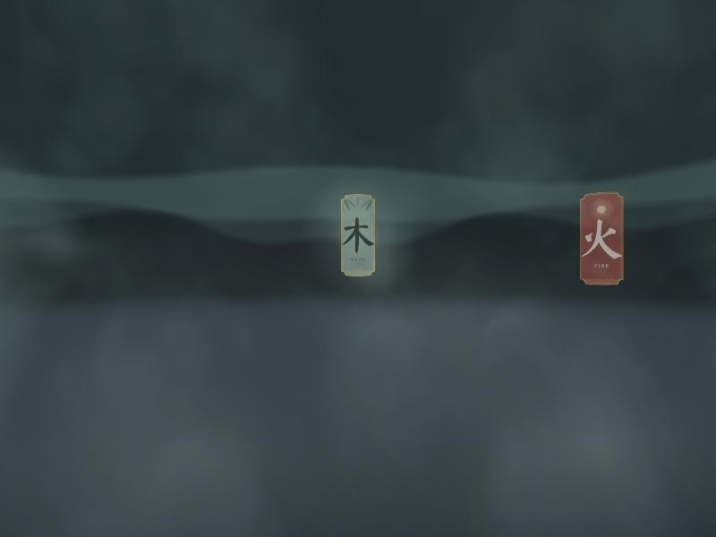

# 01 · Design Iterations

The project was built through research-through-design: each version was tested in a Meta Quest and changed by what the test showed. Four versions, each in three lines: what I tried, what went wrong, how I pivoted.

| Version | What I tried | What went wrong | How I pivoted |
|---|---|---|---|
| **V0 Inner Weather Garden** · Oct 27 – Nov 1 | A garden whose weather mirrors perimenopausal heat and cold, then the Xgrids scan in a green-ink look. | The topic needed interviews and medical care beyond the time I had; the scan itself was the strongest material. | Kept the scan and the breath. Moved to a five-element (Wuxing) meditation. |
| **V1 Card Room** · Nov 2 | A misty room with five ink cards in an arc; pinch a card to enter the Wood meditation. | In the headset everything felt about twice too big, and without a body I felt like floating. | Scene scale controls, ghost legs and hands, no text on screen, palms together to leave. |
| **V2 Element Sessions** · Nov 2 – 4 | Wood (bamboo), Fire (lantern on the bridge), Water (pond with a mirrored reflection). | Heights were hard to judge from a top view; the mirrored reflection made the water lag; the hands were stiff. | A side-view tool to pick heights, reflection off (the scan already holds the lake's reflection), hands drawn from 25 tracked joints. |
| **V3 Scattered Cards** · Nov 4 – 5 | Cards hang where each element lives, around the lake; you glide to the chosen place. | Seeing the whole garden took away the mystery; the glide made people dizzy; extra lines diluted the script. | Garden hidden until a card is chosen, a mist transition with no movement, only the author's script, a 4-2-6 breath, one voice. |

## The garden and the cards

| | |
|---|---|
|  |  |
| *The China Garden, seen from the round pavilion* | *V3 · cards glow in the mist over the lake* |
