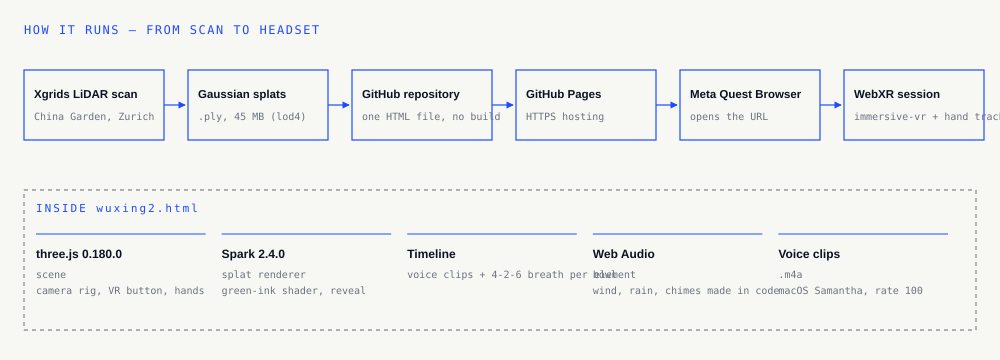

# 02 · Architecture & Setup

One HTML file, no build step. The final version is `wuxing2.html`; `wuxing.html` is V1.

## Stack

| Part | Version | Role |
|---|---|---|
| three.js | 0.180.0 | Scene, camera rig, WebXR button, hands |
| Spark | 2.4.0 | Gaussian-splat renderer, green-ink shader, cloud reveal |
| WebXR | Meta Quest Browser | `immersive-vr` with optional `hand-tracking` |
| GitHub Pages | — | HTTPS hosting (WebXR needs HTTPS) |

Libraries load from CDNs through an import map at the top of the file.

## Where to change things (in `wuxing2.html`)

| What | Look for |
|---|---|
| Breath rhythm | `BREATH_IN = 4, BREATH_HOLD = 2, BREATH_OUT = 6` |
| Voice timeline | `v2Timeline()` and `V2_DUR` |
| Scene size | `SCENE_SCALE` (0.85) |
| Where you stand | `VR_START` (Wood), `FIRE_START`, `WATER_START`, `CARD_START` |
| Card positions | `CARD_SPOTS` |
| Lantern | `FIRE_TARGET`, `FIRE_LANTERN_Y` |
| Voice loudness | `voiceGain` |

## Link parameters (for testing)

`?phase=wood|fire|water|garden` · `?skip=40` start 40 s in · `?scale=0.85` · `?lift=0.2` · `?voice=3.6` · `?transition=fly` · `?reflect=1` · `?v=…` any number to bypass the cache.

## Tools

- `map.html` — top view of the scan; hover for x, z.
- `section.html` — side view along a line; click for heights (y).
- `notebook/make-voices.sh` — regenerates every voice line: `notebook/make-voices.sh Samantha 100`.

## Troubleshooting

| Problem | Fix |
|---|---|
| The headset shows an old version | Add `?v=` with a new number; GitHub Pages needs 1–2 minutes after a push. |
| Laggy, especially Water | Keep the reflection off (default). Close other tabs. |
| No sound | Audio starts only after the first click or pinch. |
| Something sits in the wrong place in VR but looks right on desktop | In VR your real facing direction also counts; test in the headset. |
| See errors from the headset | Connect by USB, open `chrome://inspect` on the computer, inspect the Quest Browser tab. |

## Working with AI

The code was written with Claude (Anthropic) as a coding assistant: I described the experience and tested in the headset; it wrote and changed the code. Every commit message records what changed and why.
