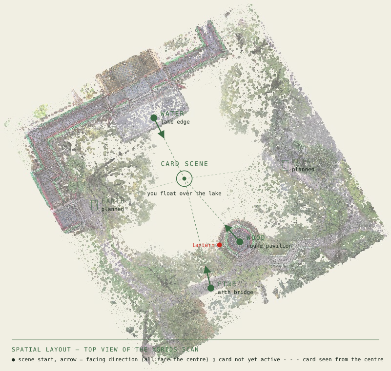
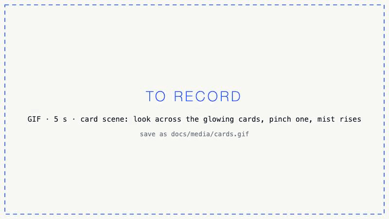
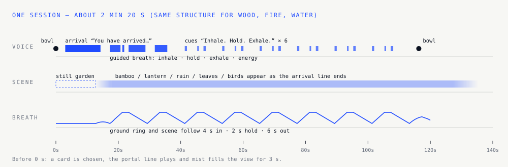
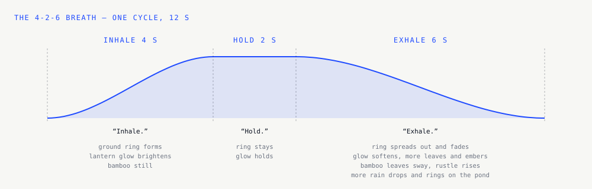
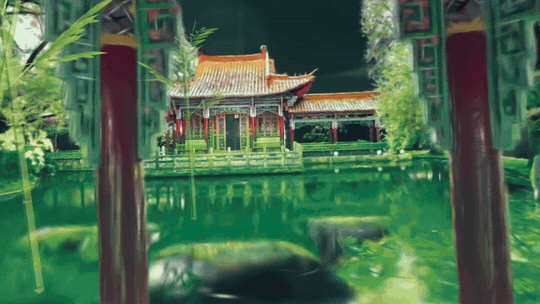
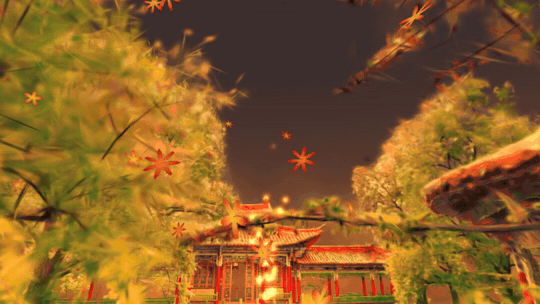
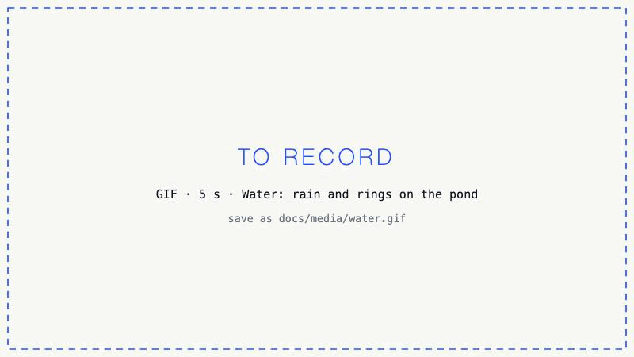
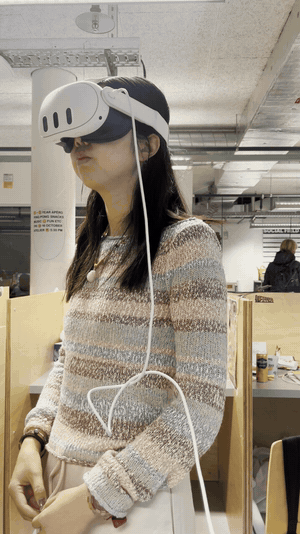
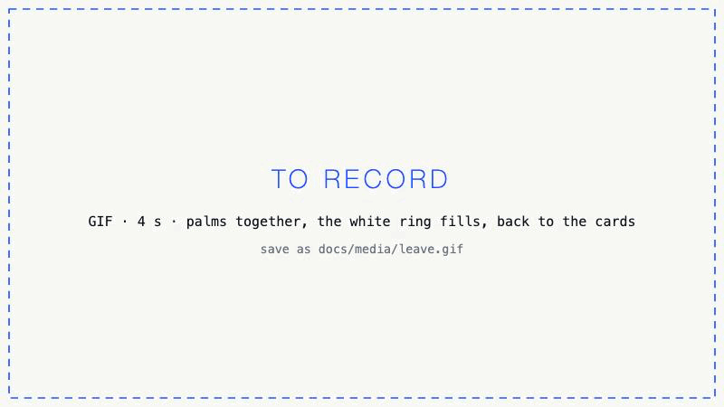

# 03 · Spatial, Audio & UX

Meditation is not a game: the design holds back. No menus, no text during a session, two gestures in total.

## Layout

You start floating over the lake in mist; only the glowing cards are visible. A chosen card fills the view with mist, and the scene opens at its own place, always facing the lake centre.

## One session

## The breath

## Senses per element

| | Wood | Fire | Water |
|---|---|---|---|
| **See** | Pale bamboo, falling leaves, a white ground ring | Red lantern, glow, embers, maple leaves | Dark pond, fine rain, rings from each drop |
| **Hear** | Wind in bamboo, rustle on the out-breath, distant birds | Soft crackle, wind chimes | Rain hiss, drops, lapping, a fish rising |
| **Breath** | Leaves sway on the out-breath | Glow brightens on the in-breath | More drops on the out-breath |
| **Clip** |  |  |  |

Sounds are placed left or right (stereo panning), not in full 3D. A singing bowl opens and closes every session.

## Interaction

| Action | Hands | Controllers |
|---|---|---|
| Choose a card | Pinch | Trigger |
| Leave a scene | Palms together, 3 s (a white ring fills) | Hold grip, 1 s |

Metal and Earth show at 20% and cannot be chosen yet.

| What you do | What you see |
|---|---|
|  |  |
